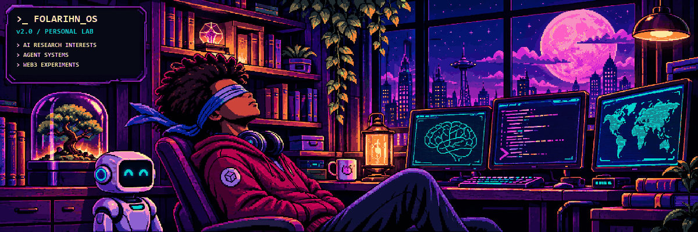
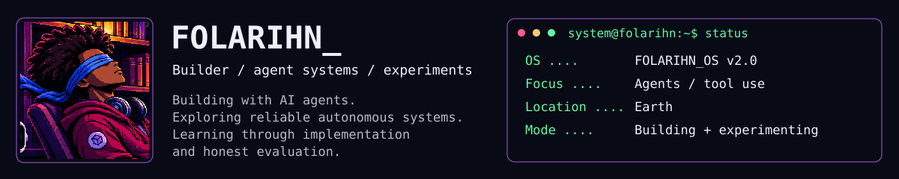
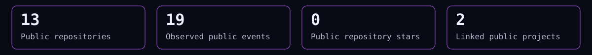
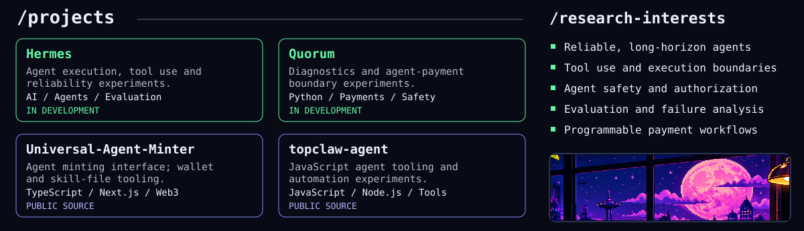
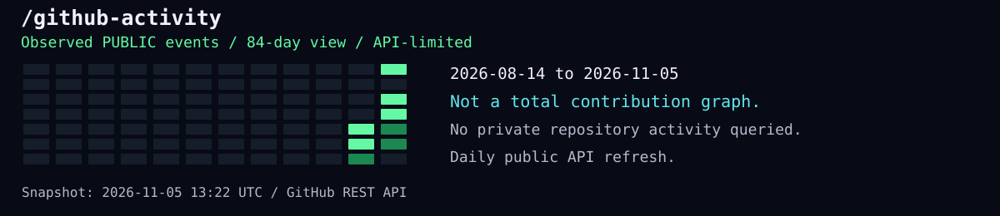
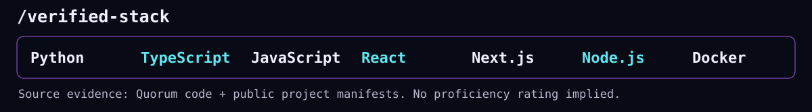

<picture>
  <source media="(prefers-reduced-motion: reduce)" srcset="assets/hero-static.png">
  <source media="(prefers-reduced-motion: no-preference)" srcset="assets/hero-animated.gif">
  
</picture>

## FOLARIHN_OS v2.0 · personal build log

I’m **Folarihn**. I build with AI agents and explore reliable autonomous systems, tool use, and programmable payments. Building, experimenting, and documenting what actually works.

<picture>
  <source media="(max-width: 600px)" srcset="assets/identity-mobile.svg">
  
</picture>
<picture>
  <source media="(max-width: 600px)" srcset="assets/generated/github-metrics-mobile.svg">
  
</picture>

<!-- PUBLIC-STATS:START -->
**13 public repositories** · **0 public repository stars** · **19 observed public events** in the API window. Snapshot: 2026-11-03 08:33 UTC. Public data only; not total contributions.
<!-- PUBLIC-STATS:END -->

<picture>
  <source media="(max-width: 600px)" srcset="assets/directory-mobile.svg">
  
</picture>

### Project directory

- **Hermes — in development.** Agent execution, tool use, and reliability experiments.
- **Quorum — in development.** Market diagnostics, unsigned payment proposals, and authorization-boundary experiments.
- **[Universal-Agent-Minter](https://github.com/folarihn/Universal-Agent-Minter) — public source.** A TypeScript/Next.js agent-minting interface with wallet and skill-file tooling.
- **[topclaw-agent](https://github.com/folarihn/topclaw-agent) — public source.** JavaScript agent tooling and automation experiments.

### Research interests

Reliable and long-horizon agents · tool use and execution boundaries · agent safety and authorization · evaluation and failure analysis · programmable payment workflows.

<picture>
  <source media="(max-width: 600px)" srcset="assets/generated/github-stats-mobile.svg">
  
</picture>

[View my native GitHub contribution calendar](https://github.com/folarihn#overview). The graphic above shows **observed public events**, not total contributions. No private-repository data is queried. A daily workflow refreshes the snapshot; this is not real-time telemetry.

<picture>
  <source media="(max-width: 600px)" srcset="assets/stack-mobile.svg">
  
</picture>

**Source-verified stack:** Python · TypeScript · JavaScript · React · Next.js · Node.js · Docker. Based on inspected project source and public manifests.

<picture>
  <source media="(max-width: 600px)" srcset="assets/footer-mobile.svg">
  
</picture>

[GitHub](https://github.com/folarihn) · [Portfolio](https://folarihnport.vercel.app/) · [Static hero](assets/hero-static.png) · [Design, motion and accessibility notes](docs/DESIGN.md)

Motion and accessibility

The hero has an eight-second loop, changing only a small cursor and a few decorative light pixels. The rest of the dashboard is static. A reduced-motion picture source and static fallback are included, but GitHub clients, proxies or direct GIF playback may not honor motion preferences. Use the static hero link for a guaranteed still image. Mobile variants simplify dense dashboard panels. Critical information and real links remain selectable above even if every image fails.

