<!-- Generated by scripts/build.py from profile.json. Edit those, not this file. -->
<a href="https://folarihnport.vercel.app/"></a>

<b>I build autonomous AI agents, the guardrails that keep them honest, and the payment rails they run on.</b> 
Agents · guardrails · escrow · private payments · on-chain intelligence — shipped from Lagos, NG

 

<table>
  <tr>
    <td width="50%"><a href="https://settlenear.xyz"></a></td>
    <td width="50%"><a href="https://zecone.xyz"></a></td>
  </tr>
  <tr>
    <td width="50%"></td>
    <td width="50%"><a href="https://tracer-pi-lyart.vercel.app"></a></td>
  </tr>
  <tr>
    <td width="50%"><a href="https://swapsea.vercel.app"></a></td>
    <td width="50%"></td>
  </tr>
  <tr>
    <td width="50%"></td>
    <td width="50%"></td>
  </tr>
</table>

<b>More builds</b>

- NFT PowerBot — Telegram NFT trading bot, Flashbots-protected, ETH + Base
- Cipher Pay — shielded Solana payments with encrypted memos



<picture>
  <source media="(prefers-color-scheme: dark)" srcset="https://raw.githubusercontent.com/folarihn/folarihn/output/snake-dark.svg">
  <source media="(prefers-color-scheme: light)" srcset="https://raw.githubusercontent.com/folarihn/folarihn/output/snake.svg">
  
</picture>

<a href="https://folarihnport.vercel.app/">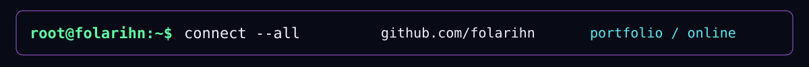</a>

<a href="https://folarihnport.vercel.app/">portfolio</a> · <a href="https://x.com/folarihn">x.com/folarihn</a> · <a href="https://settlenear.xyz">settlenear.xyz</a> · <a href="https://zecone.xyz">zecone.xyz</a>

